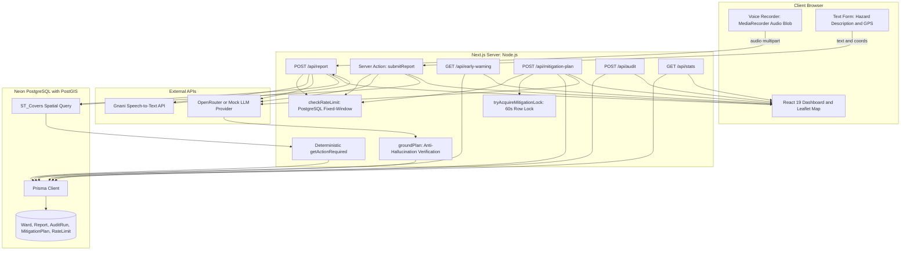

# SafaiKavach

SafaiKavach is an intake and dispatch platform for road hazards including biomedical waste, loose electrical wiring, chemical leaks, demolition debris, and open garbage heaps. It provides voice and text intake, PostGIS municipal ward tagging, deterministic dispatch routing, statistical early warning anomaly detection, and weekly mitigation plan generation. All data is synthetic.

Live deployment: https://garbage-unstop-project.vercel.app

## 2. Architecture

The system consists of a Next.js web application interfacing with Neon PostgreSQL (with PostGIS extensions), external speech-to-text services, and LLM inference providers.



### Request Flow

1. Report Intake: Spoken audio is uploaded to `/api/report` as multipart form data and transcribed by Gnani STT. Text reports are submitted directly via the `submitReport` Server Action.
2. Rate Limiting: Requests are checked against a PostgreSQL table (`RateLimit`) per client IP before running external APIs or database writes.
3. Extraction: The server passes transcripts or text to the LLM (or mock fallback) to extract hazard category, severity score (1 to 10), and location text.
4. Coordinate Resolution: Coordinates are obtained from browser GPS coordinates or matched against a static gazetteer of Delhi landmark coordinates.
5. Spatial Ward Tagging: Coordinates are matched against 290 MultiPolygon ward boundaries using PostGIS `ST_Covers`.
6. Deterministic Dispatch: Hazard category and severity determine the action required: `dispatch_hazmat_bypass_standard`, `bypass_standard`, or `routine_collection`. Clients cannot select or override this classification.
7. Storage: Validated reports are persisted to the `Report` table via Prisma.

## 3. Features and Limitations

### Spatial Ward Tagging with ST_Covers
* Capability: Automatically maps latitude and longitude coordinates to one of 290 Delhi MCD wards using the PostGIS spatial relationship `ST_Covers`.
* Limitation: Points must fall strictly inside the defined MultiPolygon boundary of a ward. Coordinates outside Delhi regional bounds or missing coordinates return an unmapped status. Wards reflect pre-2022 DataMeet boundaries (290 wards) rather than the 2022 250-ward delimitation, and certain polygons contain boundary overlaps.

### Early Warning Hotspot Detection
* Capability: Groups historical reports into four consecutive 7-day buckets (W-3, W-2, W-1, W0) per ward. Identifies wards experiencing unusual volume using standardized z-scores against baseline moving averages and estimates next-week volumes using linear trend extrapolation.
* Limitation: Requires at least four weekly buckets. Anomaly scores are standardized statistical z-scores against short-term baseline variation and are not probability percentages. Linear regression over four observations cannot model seasonal patterns, holidays, or weather shifts.

### Weekly Root-Cause Audit
* Capability: Runs bounded SQL queries over recent reports to find spatial clusters and anomalies, running DBSCAN clustering to identify the dominant category and spatial centroid. Generates hypothesis text and recommended actions.
* Limitation: Requires at least three reports of the same hazard category within a single ward in the current week. If insufficient reports exist, the audit returns an insufficient data status.

### Municipal Mitigation Strategy
* Capability: Compiles 7-day incident totals, deltas, and severity statistics into structured operational mandates. The `groundPlan` function verifies all LLM output against raw SQL aggregates to eliminate hallucinated wards, counts, or categories.
* Limitation: Synthesizes priorities only for wards with recorded incidents in the last 7 days. Causes generated by the model are unconfirmed hypotheses, not verified root causes.

## 4. Synthetic Data Methodology

The repository contains a synthetic incident dataset of 10,000 rows with ID prefix `SYN-`, plus 60 baseline test rows with ID prefix `HZ-`. All synthetic rows have `isSynthetic = true`.

* Generator: `scripts/generate_synthetic_10k.ts`, executed with fixed pseudo-random seed 42.
* Profiling Origin: Incident category ratios, 24-hour time-of-day distributions, and day-of-week patterns were profiled from public Bengaluru grievance data (126,974 records). Only solid waste and electrical categories were mapped.
* Assumptions: Construction debris (10%), chemical leaks (3%), and unknown categories (2%) were assigned as baseline assumptions because they were not present in the public source dataset.
* Spatial Placement: Incident points were sampled within Delhi MCD ward polygon geometries using a two-tier Pareto distribution where the top 25 wards receive approximately 60% of baseline volume.
* Planted Spikes: Four wards contain artificial spikes added during the most recent 7-day window (W0) to verify detection pipelines:
  * RAJENDER NAGAR (Karol Bagh): 70 biohazard incidents
  * NDMC CHARGE 2 (Connaught Place): 65 electrical hazard incidents
  * AMAR COLONY (Lajpat Nagar): 55 chemical hazard incidents
  * PANDAV NAGAR (Laxmi Nagar): 50 general overflow incidents
* Notice: These records are synthetic demonstrations and are not real Delhi incidents.

## 5. Early Warning Method, R2 Rule, and Backtest

### Method
Incidents are aggregated into four consecutive 7-day weekly windows:
* W-3: 28 to 21 days ago
* W-2: 21 to 14 days ago
* W-1: 14 to 7 days ago
* W0: 7 days ago to current timestamp

The baseline mean is calculated over the three prior weeks:
$$ \text{mean} = \frac{W_{-3} + W_{-2} + W_{-1}}{3} $$

Sample variance with 2 degrees of freedom:
$$ s^2 = \frac{\sum_{i=1}^{3} (W_{-i} - \text{mean})^2}{2} $$

Effective standard deviation applies a floor to prevent division by zero or inflated scores on low baseline counts:
$$ \text{std} = \max\left(\max(1, \sqrt{\text{mean}}), \sqrt{s^2}\right) $$

Anomaly score:
$$ z = \frac{W_0 - \text{mean}}{\text{std}} $$

Next-week volume is estimated using ordinary least squares linear regression over indices 0, 1, 2, 3 corresponding to W-3, W-2, W-1, W0.

### The R2 Classification Rule with MIN_HIGH=13
Wards are classified into risk tiers:
* High: $z \ge 2.0$ AND $W_0 \ge 13$ AND $(W_0 - \text{mean}) \ge 3$
* Medium: $z \ge 1.0$ OR (week-over-week increase $\ge 50\%$ with $W_0 \ge 2$ and $W_{-1} \ge 3$)
* Low: All other qualifying wards

### Backtest Summary (from docs/EARLY_WARNING_BACKTEST.md)
Monte Carlo evaluation was run across seeds 1, 2, 3, 4, 5 (fixed in advance, 5,000 synthetic Poisson trials per cell per seed).

#### False Alarm Rates on Null Series (High Risk)
* Baseline 1: 0.00% (range: 0.00% to 0.00%)
* Baseline 3: 0.00% (range: 0.00% to 0.00%)
* Baseline 5: 0.14% (range: 0.10% to 0.20%)
* Baseline 10: 4.38% (range: 3.86% to 4.94%)
* Baseline 20: 4.38% (range: 3.94% to 4.80%)

#### Detection Rates for 3x Spikes (High Risk)
* Baseline 1: 0.0% (range: 0.0% to 0.0%)
* Baseline 3: 12.2% (range: 11.4% to 13.1%)
* Baseline 5: 70.9% (range: 70.5% to 71.3%)
* Baseline 10: 98.1% (range: 97.8% to 98.4%)
* Baseline 20: 100.0% (range: 100.0% to 100.0%)

#### Tuning Finding
MIN_HIGH=8 fails the 5.00% false alarm limit on the worst seed at baseline 10 (reaching 5.36%). MIN_HIGH=13 is the lowest threshold that passes the 5.00% limit across all baselines on every seed 1 through 5.

#### Stated Limitations
* Anomaly scores are standardized z-scores against short-term baseline moving averages, not probabilities.
* The trend estimate is a linear extrapolation, not a trained predictive forecasting model.
* Four weekly buckets cannot support seasonal inference.
* The backtest covers simulated planted spikes and Poisson arrival processes, not naturally occurring municipal complaint behavior.

## 6. Estimated Prevented Cost

Estimated prevented cost is an illustrative estimate, not measured financial savings.

### Formula
Only reports with non-routine dispatch actions (`actionRequired` not equal to `routine_collection`) are assigned an estimated prevented cost. Routine collection reports evaluate to 0 INR.

$$ \text{Prevented Cost} = \text{Base Cost}(\text{hazardCategory}) \times \frac{\text{severityLevel}}{10} $$

If vehicle bypass routing is active, net illustrative impact subtracts detour vehicle travel cost:
$$ \text{Detour Cost} = \text{Extra Distance (km)} \times 30 \text{ INR/km} $$
$$ \text{Net Impact} = \max(0, \text{Prevented Cost} - \text{Detour Cost}) $$

### Placeholder Base Cost Assumptions
* `chemical`: 120,000 INR
* `biohazard_medical`: 85,000 INR
* `electrical_hazard`: 60,000 INR
* `construction_debris`: 40,000 INR
* `general_overflow`: 5,000 INR
* `unknown`: 10,000 INR

These values are illustrative assumptions with no external source. The dashboard header sums all non-routine rows in the database, including synthetic rows, without date bounds.

## 7. Security and Limits

### Server-Side Demo Reset Guard
The demo reset action (`resetSyntheticData`) is disabled unless `ENABLE_DEMO_RESET="true"` is set on the server. If disabled, it returns an error and executes no database queries. When enabled, it deletes only rows where `isSynthetic = true` and ID begins with `HZ-`. Rows with ID prefix `SYN-` and real user submissions are protected.

### Input Validation
All endpoints validate input using Zod schemas:
* Reports must specify non-empty text or audio.
* Latitude must fall within -90 to 90 and longitude within -180 to 180.
* Delhi bounding box checks in `validateDelhiCoordinates` verify coordinates are between longitude 76.7 to 77.6 and latitude 28.3 to 29.0.
* Invalid payloads immediately return HTTP 400 Bad Request.

### Rate Limiting
Rate limiting is enforced per client IP using fixed time windows backed by the `RateLimit` table in PostgreSQL:
* `/api/report` and `submitReport`: Limited to `RATE_LIMIT_MAX` (default 10) requests per `RATE_LIMIT_WINDOW_SECONDS` (default 600 seconds).
* `/api/transcribe`: Checked against the rate limiter.
* `/api/mitigation-plan`: Enforces both per-IP rate limiting and concurrency locking.
* Fails Open: If the database rate limit query throws, the function catches the error, logs a warning, and allows the request through so database issues do not block citizen intake.

### Mitigation Concurrency Lock
Plan generation uses an atomic database row lock (`lock:mitigation`) with a 60-second time-to-live stored in the `RateLimit` table. This prevents concurrent duplicate LLM synthesis runs across serverless instances without holding database connections open.

## 8. LLM Integration and Fallbacks

### Model Hypotheses
Root causes and operational recommendations generated by the LLM are model hypotheses, not confirmed facts.

### Provider and Model Routing
* Configuration: Controlled via `LLM_PROVIDER`, `LLM_BASE_URL`, `LLM_API_KEY`, `LLM_MODEL_EXTRACT`, and `LLM_MODEL_AUDIT`.
* Default Free Tier: The default configuration uses `openrouter/free`. Available models on free endpoints can vary per call, face upstream provider rate limits, or be deprecated without notice.
* Fallback Behavior:
  * When `LLM_PROVIDER=mock` or when external calls fail, extraction falls back to deterministic keyword matching.
  * The Weekly Audit route falls back to template text labelled: "Template text, LLM unavailable".
  * The Mitigation Plan serves the latest cached plan from the database or returns status `degraded`.

## 9. Database Schema and Spatial Query

### Prisma Schema (from prisma/schema.prisma)

```prisma
datasource db {
  provider   = "postgresql"
  url        = env("DATABASE_URL")
  directUrl  = env("DIRECT_URL")
  extensions = [postgis]
}

generator client {
  provider        = "prisma-client-js"
  previewFeatures = ["postgresqlExtensions"]
}

enum Role {
  DRIVER
  DISPATCHER
  ADMIN
}

enum HazardCategory {
  biohazard_medical
  construction_debris
  electrical_hazard
  chemical
  general_overflow
  unknown
}

enum ReportStatus {
  OPEN
  DISPATCHED
  RESOLVED
}

enum ActionRequired {
  dispatch_hazmat_bypass_standard
  bypass_standard
  routine_collection
}

model User {
  id        String   @id @default(cuid())
  name      String
  phone     String?
  role      Role     @default(DRIVER)
  wardId    String?
  ward      Ward?    @relation(fields: [wardId], references: [id])
  reports   Report[]
  createdAt DateTime @default(now())
}

model Ward {
  id           String                                  @id @default(cuid())
  externalId   String                                  @unique
  name         String
  sourceWardId String?
  geom         Unsupported("geometry(MultiPolygon, 4326)")?
  users        User[]
  reports      Report[]
  audits       AuditRun[]

  @@index([geom], type: Gist, map: "ward_geom_gist")
}

model Report {
  id                    String         @id
  hazardCategory        HazardCategory
  severityLevel         Int
  rawLocation           String
  lat                   Float?
  lng                   Float?
  transcript            String
  transcriptMock        Boolean        @default(false)
  translatedEnglish     String?
  actionRequired        ActionRequired
  status                ReportStatus   @default(OPEN)
  estimatedPreventedInr Int?
  isSynthetic           Boolean        @default(false)
  reporterId            String?
  reporter              User?          @relation(fields: [reporterId], references: [id])
  wardId                String?
  ward                  Ward?          @relation(fields: [wardId], references: [id])
  createdAt             DateTime       @default(now())
  resolvedAt            DateTime?

  @@index([wardId, createdAt])
}

model AuditRun {
  id              String   @id @default(cuid())
  wardId          String?
  ward            Ward?    @relation(fields: [wardId], references: [id])
  weekStart       DateTime
  dominantAnomaly String
  rootCause       String
  recommendation  String
  createdAt       DateTime @default(now())
}

model MitigationPlan {
  id                String   @id @default(cuid())
  windowStart       DateTime
  windowEnd         DateTime
  model             String
  includesSynthetic Boolean
  aggregatesJson    Json
  planJson          Json
  createdAt         DateTime @default(now())
}

model RateLimit {
  id          String   @id @default(cuid())
  key         String
  windowStart DateTime
  count       Int      @default(1)
  updatedAt   DateTime @updatedAt

  @@unique([key, windowStart], name: "key_windowStart")
  @@index([windowStart])
}
```

### Spatial Query (from src/lib/spatial/wardsDb.ts)

```sql
SELECT id, "externalId", name, "sourceWardId"
FROM "Ward"
WHERE ST_Covers(geom, ST_SetSRID(ST_MakePoint(${lng}::double precision, ${lat}::double precision), 4326))
ORDER BY "externalId"
LIMIT 1;
```

## 10. Setup and Installation

### Prerequisites
* Node.js 22 LTS
* PostgreSQL with PostGIS extension (e.g. Neon Postgres)

### Environment Variables

| Variable Name | Purpose | Scope |
| :--- | :--- | :--- |
| `DATABASE_URL` | Pooled PostgreSQL connection string for application queries | Server only |
| `DIRECT_URL` | Direct PostgreSQL connection string for Prisma migrations | Server only |
| `ENABLE_DEMO_RESET` | Guard enabling demo data reset functionality when set to true | Server only |
| `LLM_PROVIDER` | LLM execution mode: mock, openrouter, or evon | Server only |
| `LLM_BASE_URL` | Base URL for LLM provider API endpoint | Server only |
| `LLM_API_KEY` | API authentication key for LLM provider | Server only |
| `LLM_MODEL_EXTRACT` | Model slug for citizen report hazard extraction | Server only |
| `LLM_MODEL_AUDIT` | Model slug for weekly audit and mitigation planning | Server only |
| `GNANI_API_KEY` | API key for Gnani speech-to-text service | Server only |
| `GNANI_STT_URL` | HTTP endpoint URL for Gnani speech transcription | Server only |
| `NEXT_PUBLIC_MAP_PROVIDER` | Map tile layer provider selection | Client and Server |
| `RATE_LIMIT_MAX` | Maximum number of allowed requests per IP within a rate limit window | Server only |
| `RATE_LIMIT_WINDOW_SECONDS` | Fixed window duration in seconds for IP rate limiting | Server only |

### Setup Commands (Windows PowerShell)

```powershell
# 1. Install dependencies
npm install

# 2. Configure environment
Copy-Item .env.example .env
# Edit .env with your PostgreSQL credentials

# 3. Push database schema to PostgreSQL
npm run db:push

# 4. Import Delhi ward polygon geometries into PostGIS
npm run db:import-wards

# 5. Seed baseline demo records
npm run db:seed

# 6. Optional: Generate 10k synthetic records profiled from public Bengaluru grievance data
npm run gen:10k

# 7. Start development server
npm run dev
```

Open http://localhost:3000 in your browser.

## 11. Testing

All test commands run via Vitest. Counts below reflect verified execution on 2026-11-19.

### Unit Tests (Offline)
Unit tests run entirely in memory without network or database dependencies:
```powershell
npm test
```
Result on 2026-11-19:
* Test Files: 33 passed (33)
* Tests: 217 passed (217)
* Duration: 6.45 seconds

### Integration Tests (Database and PostGIS)
Integration tests run against a live PostgreSQL database with PostGIS:
```powershell
npm run test:int
```
Result on 2026-11-19:
* Test Files: 3 passed (3)
* Tests: 6 passed (6)
* Duration: 7.72 seconds

### Early Warning Backtest
Runs Monte Carlo simulation evaluating R2 anomaly detection across seeds 1 to 5:
```powershell
npm run backtest
```
Result on 2026-11-19:
* Seeds evaluated: 1, 2, 3, 4, 5 (5,000 trials per cell)
* Outcome: Confirms MIN_HIGH=13 satisfies the 5.00% false alarm rate limit on the worst seed across all baselines.

## 12. Known Limitations and What Is Unproven

### Known Limitations
* Synthetic Data Only: Aside from user reports entered during an active session, all data is synthetic.
* Pre-2022 Boundaries: Uses pre-2022 DataMeet ward boundary polygons (290 wards) rather than the 2022 MCD 250-ward delimitation. Boundary overlaps exist in some areas.
* Small Baseline Moving Window: Four 7-day buckets provide insufficient depth to capture seasonal shifts, holidays, or weather cycles.
* Linear Trend Extrapolation: Next-week projections represent simple linear regressions over four numbers and are not trained forecasting models.
* Statistical Scores: Anomaly scores are standardized z-scores against short-term baseline variation, not event probabilities.
* Rate Limiting Fails Open: Database rate limit errors fail open to keep intake available. Per-IP tracking does not prevent distributed abuse.
* Unpinned Free Tier Models: Free tier models on OpenRouter can vary in availability, formatting reliability, and response latency.
* Avoided Cost Assumptions: Dollar and rupee values are placeholder assumptions, not measured municipal financial savings.

### What Is Unproven
* Real-World Citizen Reporting Behavior: The system has not been tested with live municipal call volumes, batch reporting, or citizen reporting bursts.
* Noisy Audio Robustness: Speech-to-text accuracy has not been validated against noisy field audio from heavy traffic or diverse dialects.
* Production Scalability Beyond 10,000 Rows: Spatial queries scan the report table sequentially; indexing or partitioning for hundred-thousand-row tables has not been tested in production.

## 13. Screenshots

The screenshot image files `docs/screenshots/live-map.png`, `docs/screenshots/early-warning.png`, `docs/screenshots/mitigation.png`, and `docs/screenshots/demo.gif` were not found in the repository file system.
