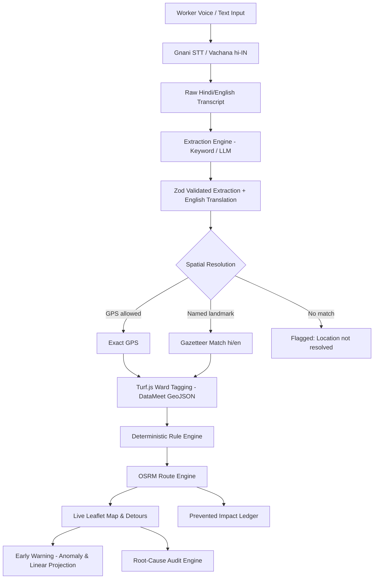

# SafaiKavach: AI Municipal Dispatch & Audit Engine

**Tagline:** Voice-first hazard intake, deterministic ward dispatch, and route bypass engine for municipal sanitation fleets.

SafaiKavach was built for the **AI First Product Builder Hackathon 2026** (Tracks: *Street Action* & *Waste Collection*). It gives sanitation workers and supervisors a fast, voice-driven interface to report road hazards (biohazards, live electrical wires, toxic chemicals, construction debris) in Hindi or English, extracts structured metadata without hallucinated coordinates, tags the incident to Delhi municipal wards, and generates truck bypass routes.

**Live Deployment:** [https://garbage-unstop-project.vercel.app/](https://garbage-unstop-project.vercel.app/)

---

## Live Demo Mode & Operational Overview

- **Speech-to-Text:** Live recording transcribes using the real Gnani STT (Vachana API in `hi-IN`). If credentials are empty or the upstream service is unreachable, it falls back gracefully to a mock transcript.
- **LLM Extraction & Auditing:** The architecture includes pluggable LLM support via OpenRouter (`openrouter/free` or custom OpenAI-compatible models). By default, if no external LLM key is configured, the live web deployment runs in **mock/keyword-based extraction mode**, reliably deriving categories, severity, and audit reports without failing.
- **Evon Adapter:** The architecture is designed for Evon deployment; the `evon` provider config is wired into the environment schema but is currently not live.

---

## What the System Does

1. **Voice & Text Hazard Reporting**
   - **Audio Intake:** Workers record directly in the browser. Audio is resampled to 16 kHz mono WAV and sent to Gnani STT.
   - **Buffer Protection:** Enforces a 600 ms minimum audio duration threshold to prevent 0-byte corrupt recordings from hitting `decodeAudioData`.
   - **Text Fallback:** Provides one-click sample hazard buttons and manual text input when microphone access is unavailable.

2. **Hazard Extraction & Translation**
   - Raw transcripts (Hindi, Hinglish, or English) are parsed into a strict Zod-validated schema:
     - `hazard_category`: Strictly mapped to 6 categories (`biohazard_medical`, `construction_debris`, `electrical_hazard`, `chemical`, `general_overflow`, `unknown`).
     - `severity_level`: Integer 1 to 10 based on immediate physical risk.
     - `raw_location`: Spoken place or landmark name.
     - `translated_english`: Provides English translations for Hindi transcripts.
   - **Resilience:** Strips `<think>` blocks, performs single-retry repair on invalid JSON, and degrades cleanly to `{ hazard_category: "unknown", severity_level: 5 }` with an on-screen diagnostic badge if an upstream API error occurs.

3. **Deterministic Spatial Resolution & Ward Tagging**
   - **No Hallucinated Coordinates:** The LLM is strictly prohibited from inventing lat/long.
   - **Resolution Hierarchy:**
     1. Device GPS (if browser geolocation is permitted).
     2. Gazetteer lookup against 15 Delhi landmarks (e.g., Connaught Place, Karol Bagh, Lajpat Nagar, with both English and Devanagari aliases like `करोल बाग`, `कनॉट प्लेस`).
     3. Unresolved: Saved with a clear *"Location not resolved"* badge; never dropped or faked.
   - **Ward Boundaries:** Tagged using Turf.js (`@turf/turf`) point-in-polygon matching against DataMeet ward GeoJSON (`data/delhi_wards.json`, which may predate the 2022 delimitation).

4. **Deterministic Dispatch Rules & Routing**
   - Routing and dispatch decisions are **100% rule-based code**:
     - `dispatch_hazmat_bypass_standard`: Category is `biohazard_medical`, `chemical`, or `electrical_hazard` with Severity $\ge 6$. Standard truck is rerouted, specialized cleanup response is dispatched.
     - `bypass_standard`: Severity $\ge 7$ for non-hazmat hazards. Standard collection truck bypasses the hazard area.
     - `routine_collection`: All lower severity reports.
   - **Route Engine:** Calculates planned, bypass, and hazmat routes using the public OSRM (Open Source Routing Machine) API with geodesic fallbacks if OSRM is unreachable.

5. **Live Interactive Map & Early Warning Panel**
   - **Live Map:** Interactive Leaflet map displaying active hazards, severity markers, ward polygons, and vehicle detour trajectories.
   - **Early Warning:** Computes weekly buckets over a 4-week window (W-3, W-2, W-1, W0). Uses an **anomaly score** (`(this_week - mean) / max(1, std)`) and a **linear least-squares projection** to highlight ward risk levels (`high`, `medium`, `low`).
   - **Financial Ledger:** Calculates an estimated municipal damage prevention figure based on transparent baseline formulas (prevented medical/equipment damages minus detour transit costs).

6. **Weekly Audit Engine**
   - Groups multi-week reports into `(ward, category)` clusters.
   - Ranks groups by highest absolute increase (`this_week - prev_week`) with a $\ge 3$ incident threshold.
   - Produces a root-cause breakdown and departmental mitigation action plan.

---

## Honest Scope & Limitations

To keep this hackathon project transparent and grounded:
- **Synthetic Demonstration Data:** The demo comes preloaded with 60 synthetic reports across Delhi (`data/seed_raw.json` / `src/data/seed_reports.ts`) calibrated to demonstrate multi-week trend detection. Real submissions are saved directly to browser `localStorage`.
- **Database:** Prisma schema definitions are present for architectural demonstration (`prisma/schema.prisma`), but there is no live PostgreSQL database running in production.
- **Ward Boundaries:** The spatial map uses DataMeet's open-source Delhi ward GeoJSON, which may predate the 2022 municipal ward delimitation.
- **Financial Numbers:** Prevented financial impact figures (`src/lib/finance/assumptions.ts`) are **illustrative assumptions**, not audited municipal ledgers.
- **OSRM Demo Server:** Road routing relies on the public open-source OSRM demo server and illustrative depot anchors (Karol Bagh depot, Okhla transfer station).

---

## Architecture Flow



---

## Tech Stack

| Layer | Technology | Purpose |
|---|---|---|
| **Framework** | Next.js 16 (App Router), React 19, TypeScript | Web app & serverless API endpoints |
| **Styling** | Tailwind CSS | Operational municipal dashboard |
| **Mapping** | Leaflet, React-Leaflet, Turf.js | DataMeet ward boundaries, hazard markers, detour lines |
| **Speech-to-Text** | Gnani Vachana STT API (`hi-IN`) | Indian-language voice transcription |
| **Extraction / Audit** | Pluggable (Keyword fallback / OpenRouter) | Structured JSON hazard extraction & translation |
| **Validation** | Zod | Runtime schema validation |
| **Routing** | OSRM (Open Source Routing Machine) | Turn-by-turn road routes and bypasses |
| **Testing** | Vitest | 36 unit tests covering routing, LLM, wards, and audit |

---

## Getting Started Locally

### 1. Clone & Install
```bash
git clone https://github.com/kaizen105/Garbage_unstop_project.git
cd Garbage_unstop_project
npm install
```

### 2. Configure Environment
Create a `.env` file in the root directory:
```env
# Optional: Gnani Vachana STT (if empty, uses fallback mock)
GNANI_API_KEY=
GNANI_STT_URL=https://api.vachana.ai/stt/v3

# LLM Provider (mock | openrouter | evon)
LLM_PROVIDER=openrouter
LLM_BASE_URL=https://openrouter.ai/api/v1
LLM_API_KEY=your_openrouter_api_key_here
LLM_MODEL_EXTRACT=openrouter/free
LLM_MODEL_AUDIT=openrouter/free

# Map provider
NEXT_PUBLIC_MAP_PROVIDER=leaflet
```

*(Note: Setting `LLM_PROVIDER=mock` allows 100% offline local development without external API calls).*

### 3. Run Dev Server
```bash
npm run dev
```
Open [http://localhost:3000](http://localhost:3000) in your browser.

---

## Verification & Testing

Every commit is verified with automated tests, type checking, and linting:

```bash
# Run 36 Vitest unit tests
npm test

# Run TypeScript compilation check
npm run typecheck

# Run ESLint validation
npm run lint

# Build production bundle
npm run build
```

**Test Coverage Highlights:**
- **36 / 36 unit tests passing**
- STT audio payload validation, size limits, and 503 retry mechanics
- Turf.js spatial ward point-in-polygon matching and unmapped boundary fallbacks
- OSRM route parsing, detour cost formulas, and geodesic fallbacks
- Anomaly cluster rankings with tie-break stability
- Zod schema validations across all API inputs

---

## Authors & Hackathon Submission
Built for the **AI First Product Builder Hackathon 2026** by:
- **Yash Sharma** ([@kaizen105](https://github.com/kaizen105))

**Project Links:**
- **Live URL:** [https://garbage-unstop-project.vercel.app/](https://garbage-unstop-project.vercel.app/)
- **Repository:** [https://github.com/kaizen105/Garbage_unstop_project](https://github.com/kaizen105/Garbage_unstop_project)
