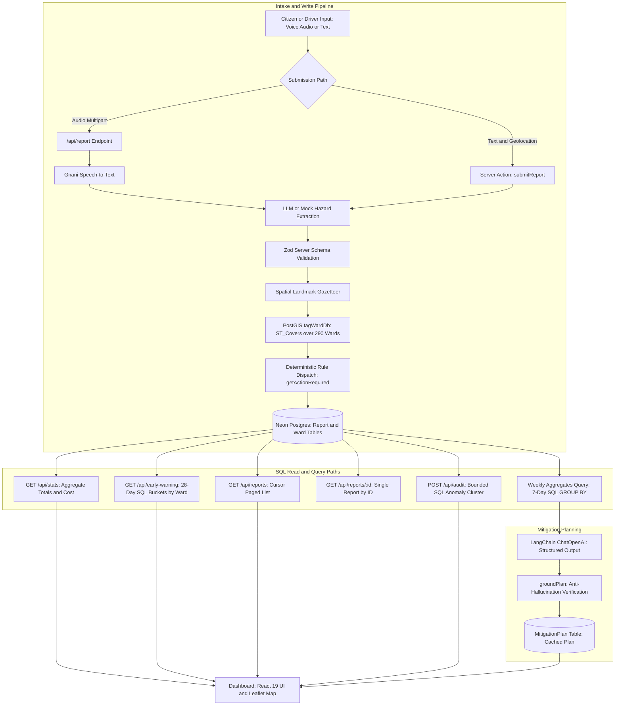

# SafaiKavach

Voice-first municipal hazard intake, PostGIS ward dispatch, and grounded weekly mitigation planning for Delhi sanitation fleets.

Live deployment: https://garbage-unstop-project.vercel.app/

SafaiKavach gives municipal staff and citizens a way to report road hazards (biomedical waste, loose electrical wiring, chemical leaks, demolition debris, and open garbage heaps) by voice or text. Reports are validated on the server, tagged to Delhi municipal wards through spatial PostGIS queries, routed to field teams using deterministic rules, and aggregated weekly into structured mitigation plans grounded against verified SQL totals.

## Architecture

### Data Flow



### Write Pipeline Stages

1. Report Intake: Spoken audio is transcribed via Gnani STT (or mock fallback) through `/api/report`. Text reports submit through the `submitReport` Server Action.
2. Server Extraction: The server parses transcripts or text using an LLM or keyword fallback into a hazard category, severity score (1 to 10), and location text.
3. Coordinates and Spatial Tagging: Coordinates are resolved from browser GPS or Delhi landmark gazetteer matching. The server executes a PostGIS `ST_Covers` query over 290 MultiPolygon ward boundaries indexed with GiST in Neon Postgres.
4. Deterministic Dispatch: Hazard category and severity determine the action required (`dispatch_hazmat_bypass_standard`, `bypass_standard`, or `routine_collection`). The client cannot choose or override this value.
5. Storage: Reports are written to the `Report` table in Postgres using Prisma.

### SQL Read Paths

* `/api/stats`: Computes total report count, high severity count (severity >= 7), average severity, hazmat action count, and estimated prevented cost in a single SQL query directly against the `Report` table.
* `/api/early-warning`: Aggregates reports over a 28 day window into 4 weekly buckets (W-3, W-2, W-1, W0), grouped in SQL by `COALESCE(w.name, r.rawLocation)` and `hazardCategory`. Hotspots are ranked by anomaly score `(w0 - mean) / std` and linear projection slope. Also returns citywide weekly category totals and per-ward W0 counts.
* `/api/reports`: Returns a cursor-paged list of reports with query parameters `limit` (default 50, maximum 200) and optional `cursor` (report ID). Returns `{ reports, nextCursor }`.
* `/api/reports/[id]`: Returns a single report by ID (`{ report }`), or 404 if not found.
* `/api/audit`: When called with an empty body (`{}`), executes a bounded SQL anomaly query against the database (`findLargestAnomalyFromDb`) to locate the largest spatial cluster in recent reports and run DBSCAN clustering without loading reports into client state. If an explicit reports array is provided in the body, it accepts up to 500 reports.
* `/api/mitigation-plan`: Parameterized SQL query grouping the last 7 days of incidents by ward and hazard category. LangChain passes these aggregates to an LLM with structured output. The server verifies every recommended ward and category against the SQL results via `groundPlan`, enriches items with exact database numbers, and caches the record in the `MitigationPlan` table.

## Pipeline Trace

Both `submitReport` and `/api/report` return a real per-stage pipeline trace (`PipelineTrace`) measuring execution duration:

* Speech-to-text (audio submission path only)
* LLM extraction (detail: degraded fallback or standard model)
* Coordinate resolution (detail: gps, gazetteer, or unresolved)
* Ward tagging (detail: matched ward name or unmapped; recorded only when coordinates exist)
* Dispatch rule (detail: action required enum)
* Database write (detail: created report ID)

Stage timings are captured using `performance.now()`. These timings represent single-request wall-clock times under current server conditions, not synthetic benchmark metrics.

## Dashboard

The dashboard provides real-time monitoring and dispatch oversight:

* Dispatch Badges: Visual status badges indicating required response actions (`dispatch_hazmat_bypass_standard`, `bypass_standard`, or `routine_collection`).
* FlyTo Animation: Selecting an incident triggers smooth map animation (`flyTo`) centering the viewport on the incident coordinates.
* Selected Ward Highlight: Clicking a report highlights the polygon boundary of its assigned ward in cyan.
* Health Status Pill: Queries `/api/health` to display database connectivity, loaded ward count (290), total report count, and demo reset status.
* Reset Demo Data Button: Displayed in the UI only when `ENABLE_DEMO_RESET` is `"true"`. Deletes only synthetic demo rows with ID prefix `HZ-` and reseeds the 60 baseline demo records. It preserves `SYN-` records.
* OpenStreetMap Dark Filter: Renders base map tiles with a custom CSS inversion and hue rotation filter (`leaflet-tile-dark`) for readability in low-light environments.
* Marker Cap: Renders map markers for up to the latest 300 loaded reports with an on-screen note to ensure map interaction remains smooth.
* Load More Paging: The reports list loads in batches of 50 using cursor-based pagination via a "Load more" button.

## Synthetic Dataset

The system includes a 10,000 row synthetic incident dataset (`SYN-` prefix) in addition to 60 baseline seed rows (`HZ-` prefix), all marked with `isSynthetic: true`.

* Generator: `scripts/generate_synthetic_10k.ts`, executed with a fixed pseudo-random seed of 42.
* CLI Flags: Supports `--dry-run` to simulate generation without database queries or writes, and `--delete-batch` to remove existing `SYN-` records.
* Profiling Origin: Incident category ratios, hour-of-day distributions (24 weights), and weekday weights were profiled from a public Bengaluru BBMP grievance dataset (126,974 records). Only Electrical and Solid Waste Related categories were mapped; all other grievance categories were excluded. The source CSV is excluded from version control.
* Category Mapping:
  * Solid Waste (Garbage) Related maps to `general_overflow`.
  * Electrical maps to `electrical_hazard`.
  * Biohazard incidents are derived from the "Dead animal(s)" subcategory under Solid Waste.
  * Construction debris (10%), chemical (3%), and unknown (2%) are assumed baseline proportions, not measured values.
* Spatial Distribution: Ward allocation follows a two-tier Pareto distribution where the top 25 wards receive approximately 60% of baseline traffic.
* Planted Spikes: Four wards contain artificial incident spikes concentrated in the most recent 7 days (W0) added on top of baseline volume:
  * RAJENDER NAGAR (Karol Bagh area): 70 biohazard incidents
  * NDMC CHARGE 2: 65 electrical hazard incidents
  * AMAR COLONY: 55 chemical hazard incidents
  * PANDAV NAGAR: 50 general overflow incidents
* Notice on Data: This dataset is entirely synthetic and does not represent official Delhi municipal complaint records. The planted spikes exist to test the early warning detection pipeline.

## Verification and Spatial Benchmark

### Point-in-Polygon Verification

All 10,000 synthetic records were verified with `ST_Covers` against their saved ward geometry:

```sql
SELECT
  COUNT(*) AS total_synthetic,
  COUNT(CASE WHEN r."wardId" IS NULL THEN 1 END) AS missing_ward,
  COUNT(CASE WHEN NOT ST_Covers(w.geom, ST_SetSRID(ST_MakePoint(r.lng, r.lat), 4326)) THEN 1 END) AS outside_ward
FROM "Report" r
LEFT JOIN "Ward" w ON r."wardId" = w.id
WHERE r."isSynthetic" = true AND r.id LIKE 'SYN-%';
```

Result: 10,000 verified rows, 0 outside their assigned ward, 0 missing a ward relation.

### Spatial Join Benchmark

Spatial join querying all report coordinates against all 290 MCD ward polygons:

```sql
EXPLAIN ANALYZE
SELECT r.id, w."externalId"
FROM "Report" r
JOIN "Ward" w
  ON ST_Covers(w.geom, ST_SetSRID(ST_MakePoint(r.lng, r.lat), 4326))
WHERE r."isSynthetic" = true;
```

Execution characteristics:
* Query plan: Sequential Scan on `Report` with nested Index Scan on `Ward` using the GiST spatial index `ward_geom_gist`.
* Execution time: 140 to 150 ms against a live Neon Postgres instance over the network.
* Note: This timing represents a single query execution over network latency to Neon Postgres, not a high-throughput scalability claim.

### Note on Ward 192 Composite Keys

The source GeoJSON dataset contains two separate wards sharing the same `ward_id` ("192"): index 82 (`GREATER KAILASH-I`) and index 192 (`Ward 192`). To prevent key collisions during database imports and synthetic data sampling, wards are identified by a unique composite external identifier (`<ward_id>-<NAME-SLUGGED>`), yielding `192-GREATER-KAILASH-I` and `192-WARD-192`.

## Key Design Decisions

* Counting stays in SQL: The LLM never calculates counts, sums, or percentage changes. Postgres performs all grouping, counting, and severity averages. The LLM only generates qualitative hypotheses, urgency ratings, and operational tasks.
* Anti-hallucination grounding: The `groundPlan` function checks every priority returned by the LLM against the actual weekly SQL aggregates. If the model references an unknown wardKey or hazard category, or provides duplicate priorities, the plan is rejected with a `GroundingError`.
* Zero raw text sent to mitigation LLM: Citizen voice transcripts, raw location notes, and PII are never passed to the mitigation model. The prompt receives only structured ward keys, ward names, categories, counts, and severity statistics.
* Server-controlled dispatch rules: The browser client never supplies `hazard_category`, `severity_level`, or `action_required`. All categorization, severity scoring, and routing rules execute strictly on the server.
* Stable ward externalId slug: Composite slug keys ensure multi-polygon features sharing numeric IDs import into distinct database rows.

## Tech Stack

* Framework: Next.js 16.4 (App Router, Turbopack, Cache Components, Partial Prerendering)
* Language: TypeScript (strict mode, no any)
* Database: Neon PostgreSQL with PostGIS extension (290 Delhi MCD MultiPolygon wards, GiST spatial index)
* ORM: Prisma 6.19
* AI and LLM: LangChain (`@langchain/core`, `@langchain/openai`) via OpenRouter, with built-in mock fallback
* Speech-to-Text: Gnani Vachana STT API (`hi-IN`) with mock fallback
* Maps: Leaflet, React-Leaflet, with fallback Turf.js spatial helpers
* Testing: Vitest (unit tests mock-isolated; separate integration suite for database)
* Container: Docker multi-stage build on Debian `node:22-slim`

## Getting Started

### Prerequisites

* Node.js 22 LTS
* PostgreSQL instance with PostGIS extension enabled (such as Neon Postgres)

### Installation

Clone the repository and install dependencies:

```bash
git clone https://github.com/kaizen105/Garbage_unstop_project.git
cd Garbage_unstop_project
npm install
```

### Environment Configuration

Copy `.env.example` to `.env` and fill in the required variables:

```bash
cp .env.example .env
```

Environment variables configured in `.env.example`:

* `DATABASE_URL`: Pooled connection string for Neon PostgreSQL.
* `DIRECT_URL`: Direct connection string for PostgreSQL schema migrations and pushes.
* `ENABLE_DEMO_RESET`: When set to "true", enables the Reset demo data button on the dashboard.
* `LLM_PROVIDER`: Provider mode (`mock`, `openrouter`, or `evon`). Defaults to `mock`.
* `LLM_BASE_URL`: Base URL for OpenRouter or custom endpoint (defaults to `https://openrouter.ai/api/v1`).
* `LLM_API_KEY`: API key for the LLM provider. The code also accepts `OPENROUTER_API_KEY` as an alias.
* `LLM_MODEL_EXTRACT`: Model slug for hazard extraction (defaults to `openrouter/free`).
* `LLM_MODEL_AUDIT`: Model slug for audit and mitigation planning (defaults to `openrouter/free`).
* `GNANI_API_KEY`: API key for Gnani speech transcription service. Optional; falls back to mock if empty.
* `GNANI_STT_URL`: URL for Gnani speech-to-text service.
* `NEXT_PUBLIC_MAP_PROVIDER`: Map tile provider (`leaflet` or `mapbox`, defaults to `leaflet`).

### Database Setup and Seeding

Run database schema setup and ward polygon imports in this exact order:

```bash
# Push Prisma schema to Postgres
npm run db:push

# Import Delhi ward boundaries into PostGIS (requires data/delhi_wards.json)
npm run db:import-wards

# Seed database with initial synthetic reports and tag them against PostGIS
npm run db:seed
```

### Start Development Server

```bash
npm run dev
```

Open [http://localhost:3000](http://localhost:3000) in your browser.

## Scripts and Commands

```bash
# Profile grievance CSV to extract category distributions and time weights
npm run profile

# Dry-run synthetic generation (simulates 10k rows without DB connection or writes)
npm run gen:10k:dry

# Generate 10k synthetic records and insert into PostgreSQL
npm run gen:10k

# Delete all generated synthetic records from PostgreSQL
npx tsx scripts/generate_synthetic_10k.ts --delete-batch
```

Warning: `npm run gen:10k` writes directly to the database connection specified in `.env` (the same database instance used by Vercel deployments). Always test changes with `npm run gen:10k:dry` before running database inserts.

## Testing

The project maintains two distinct test setups:

```bash
# Run unit tests (83 tests across 20 suites, completely offline, no DB or network access)
npm test

# Run integration tests (validates PostGIS ST_Covers queries and SQL aggregation against live Postgres)
npm run test:int
```

Continuous integration in GitHub Actions (`.github/workflows/test.yml`) runs unit tests only (`npm test`) alongside type checking and linting. Integration tests are not run in CI because no database service is provisioned during the workflow.

## Docker Deployment

The Dockerfile uses a multi-stage Debian build (`node:22-slim`) with non-root execution (`nextjs:nodejs`), producing a standalone Next.js server image.

### Building the Image

Build the container image locally without database credentials or build secrets:

```bash
docker build -t safaikavach:local .
```

### Running the Container

All credentials must be supplied at runtime only:

```bash
docker run -p 3000:3000 --env-file .env safaikavach:local
```

## Known Limitations

* Synthetic base data: All baseline incident records are synthetic demo data, except for live reports submitted during an active session.
* Pre-2022 ward boundaries: Ward polygons originate from DataMeet GeoJSON and predate the 2022 MCD 250-ward delimitation. Certain polygons feature boundary overlaps (for example, KHANPUR and TIGRI).
* Ward highlight collision: In `findWardFeature.ts` and `HazardMap.tsx`, ward lookup and React keys use `ward_id` alone. Because two wards share `ward_id` "192", selecting an incident in `Ward 192` resolves to index 82 (`GREATER KAILASH-I`) and highlights its boundary instead.
* OpenStreetMap tile usage: The public OpenStreetMap tile server is intended for development and low-volume evaluation only. Production deployments should use a dedicated tile provider.
* Unpinned LLM router: The default extraction and audit model slug `openrouter/free` dynamically routes requests to available free models, which may vary in output formatting reliability.
* Biohazard data source: Biohazard proportions were derived from municipal animal carcass removal requests rather than clinical or hazardous medical waste filings.
* Loaded report map limit: The live map displays markers only for reports currently loaded into client view state (capped at the latest 300 reports), rather than all 10,000 database rows.
* Unauthenticated write actions: The `submitReport` server action and `/api/report` endpoint currently lack authentication and per-IP rate limiting.

## Project Structure

```
├── .github/
│   └── workflows/        # GitHub Actions continuous integration workflow (test.yml)
├── data/                 # Delhi ward polygons, landmark gazetteer, and profile cache
├── prisma/               # Prisma PostGIS schema definition and seed scripts
├── public/               # Static assets and web icons
├── scripts/              # Data generation, grievance profiler, and boundary import scripts
│   └── data/             # Transcript templates for synthetic incident generation
├── src/
│   ├── app/              # Next.js App Router pages, Server Actions, and API route handlers
│   │   ├── actions/      # Server Actions (submitReport, resetSyntheticData)
│   │   └── api/          # Route handlers (reports, stats, early-warning, audit, health)
│   ├── components/       # React UI components
│   │   ├── dashboard/    # Analytics panels, stats cards, and action buttons
│   │   ├── map/          # Leaflet map container and polygon layer rendering
│   │   └── voice/        # Voice recording and transcription intake interface
│   ├── data/             # Static report seed definitions
│   ├── lib/              # Core business logic and shared utilities
│   │   ├── audit/        # Anomaly clustering and audit generation
│   │   ├── db/           # Prisma client singleton
│   │   ├── early-warning/# Trend calculation and SQL bucket conversion
│   │   ├── finance/      # Prevented damage cost estimation formulas
│   │   ├── gnani/        # Speech-to-text API client
│   │   ├── llm/          # Model prompt chains and extraction parsers
│   │   ├── mitigation/   # SQL aggregation and anti-hallucination grounding
│   │   ├── reports/      # Report service and data transfer mapping
│   │   ├── routing/      # Road routing and detour computation
│   │   ├── spatial/      # PostGIS queries, gazetteer lookup, and Turf fallbacks
│   │   ├── store/        # Client state management context
│   │   ├── utils/        # Text and status formatting helpers
│   │   └── validation/   # Zod validation schemas
│   └── types/            # TypeScript ambient type declarations
├── Dockerfile            # Multi-stage production container build definition
├── next.config.ts        # Next.js configuration
├── package.json          # Project dependencies, scripts, and engine specifications
└── tsconfig.json         # TypeScript compiler configuration
```
