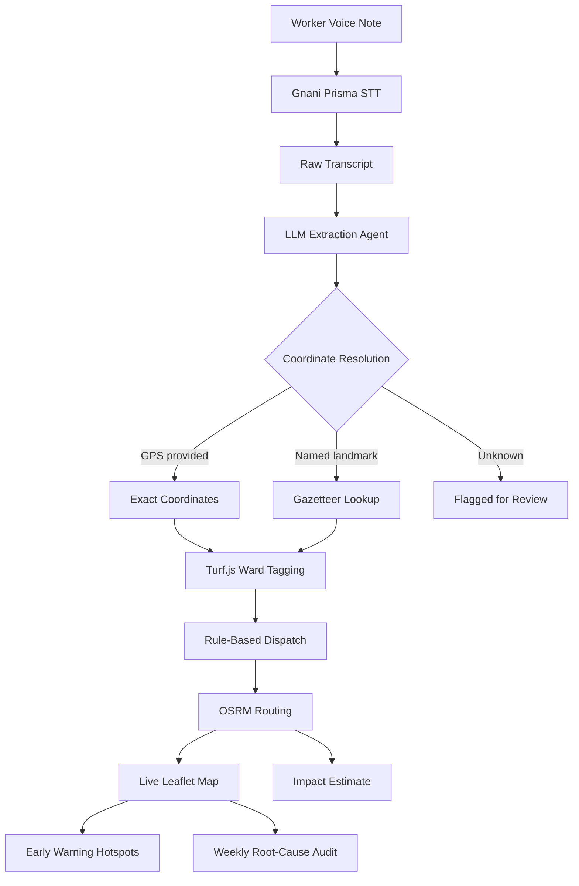

# SafaiKavach: AI Municipal Dispatch & Audit Engine

**Tagline:** AI-powered voice dispatch and predictive hazard routing for municipal sanitation workers.

SafaiKavach is a comprehensive municipal dispatch engine built to protect sanitation workers from encountering hazardous materials without warning. By enabling voice-based incident reporting via an intuitive field interface, the platform translates unstructured worker voice notes into structured geographic and logistical data. This allows municipal fleet managers to dynamically reroute standard collection vehicles while dispatching specialized hazmat teams, minimizing exposure and improving urban sanitation efficiency. 

## The Problem
Sanitation workers frequently encounter hazardous waste (medical waste, dangerous chemicals, or heavy industrial debris) on standard routes without prior warning. Current systems lack a structured mechanism for field workers to instantly report anomalies, leaving them vulnerable to health risks and causing collection delays. Furthermore, fleet managers operate blindly without historical spatial data to identify recurring hazardous hotspots, leading to inefficient routing and escalating mitigation costs.

## Features
- **Voice Intake in Hindi & English:** A responsive, single-button voice interface designed for quick, on-the-go reporting in noisy environments.
- **AI Extraction & Zod Validation:** Converts unstructured voice transcripts into rigorously typed geographic hazards using OpenAI-compatible LLMs.
- **Ward Tagging & Resolution:** Employs hierarchical spatial resolution (GPS > Gazetteer Landmark Lookup) integrated with Turf.js against Delhi MCD ward boundaries.
- **Live Map Dashboard:** Interactive geographic interface displaying real-time incidents categorized by severity, with hotspot shading indicating weekly trends.
- **Hazard Bypass & Hazmat Routing:** Calculates adaptive OSRM routes, standardizing a bypass route for regular fleet and a direct route for specialized cleanup crews.
- **Estimated Financial Impact:** Logs a real-time ledger of simulated municipal savings derived from prevented exposure, injuries, and routing overhead.
- **Weekly Root-Cause Audit:** Triggers an automated LLM-driven root-cause investigation across incident clusters, identifying systemic compliance failures.
- **Early Warning Hotspots:** Utilizes anomalous incident spike detection across municipal wards to project impending risks and assign predictive threat levels.

## Architecture



### Technology Stack
| Layer | Technologies Used |
|-------|-------------------|
| **Frontend Framework** | Next.js 16.4 (App Router), React, TypeScript |
| **Styling** | Tailwind CSS, Lucide React (Icons) |
| **Mapping & Geospatial** | Leaflet, React-Leaflet, Turf.js |
| **Voice Processing** | MediaRecorder API, Gnani Prisma STT |
| **AI / LLM Orchestration** | OpenRouter (OpenAI-compatible endpoints), Zod |
| **Routing Provider** | Open Source Routing Machine (OSRM) Demo API |

## Design Principles
- **No LLM Hallucinations:** The AI never invents or guesses coordinates. All spatial data is derived from actual GPS or deterministic gazetteer mapping.
- **Deterministic Dispatch:** Dispatch actions and routing logic are entirely rule-based and not left to LLM decision-making.
- **Strict Validation:** All external input, from STT transcripts to LLM extractions, is meticulously verified via Zod schemas.
- **Resilience:** Every external API call (STT, LLM, Routing) utilizes timeouts, multi-attempt retries, and graceful fallbacks.
- **Mock Mode First:** The demo is engineered to function flawlessly in fully offline/mock modes without requiring active API keys.

## Getting Started

### Prerequisites
- Node.js (v18+)
- npm or pnpm

### Installation
```bash
git clone https://github.com/kaizen105/Garbage_unstop_project.git
cd Garbage_unstop_project
npm install
```

### Environment Variables
Copy `.env.example` to `.env` or `.env.local` and populate the required keys.

| Variable | Description | Required | Default / Mock Behavior |
|----------|-------------|----------|-------------------------|
| `LLM_PROVIDER` | Defines the LLM strategy (`mock`, `openrouter`, `evon`). | No | `mock` |
| `LLM_BASE_URL` | Base endpoint for the chosen LLM provider. | No | - |
| `LLM_API_KEY` | Bearer token for LLM authentication. | No | - |
| `LLM_MODEL_EXTRACT` | Model used for hazard JSON extraction. | No | - |
| `LLM_MODEL_AUDIT` | Model used for root-cause analysis audits. | No | - |
| `GNANI_API_KEY` | API Key for the Gnani STT service. | No | Mock returns static transcript |
| `GNANI_STT_URL` | Endpoint for the Gnani Prisma STT API. | No | - |

*(Note: Setting `LLM_PROVIDER=mock` and omitting the Gnani API key will run the application entirely in synthetic offline mode).*

### Running the App
```bash
# Start the development server
npm run dev

# Run full TypeScript validation
npm run typecheck

# Run unit tests
npm test

# Build for production
npm run build
```

## API Reference

| Endpoint | Method | Input (Body/Query) | Output / Action |
|----------|--------|--------------------|-----------------|
| `/api/transcribe` | POST | FormData (audio file, config) | `{ success, transcript, request_id }` |
| `/api/report` | POST | `{ transcript, coords? }` | Validated `HazardReport` |
| `/api/route` | POST | `{ coordinates: [lon, lat][] }` | `{ planned, bypass, hazmat }` |
| `/api/audit` | POST | `{ cluster: HazardReport[] }` | `{ root_cause, mitigation }` |
| `/api/wards` | GET | None | Delhi MCD GeoJSON FeatureCollection |

## Data & Honesty Declaration
- **Synthetic Demo Data:** All incident reports are artificially generated (`src/data/seed_reports.ts`) to simulate a 4-week historical trend.
- **Illustrative Financials:** Cost figures (in INR) representing prevented damages are hardcoded assumptions (`src/lib/finance/assumptions.ts`) and do not reflect real-world municipal budgets.
- **Ward Boundaries:** The spatial map utilizes DataMeet's historical open-source Delhi MCD ward boundaries, which may predate the 2022 MCD delimitation.
- **Routing Engine:** We utilize the public OSRM demo server for route approximations.
- **Predictive Anomalies:** The "Early Warning" system employs a naive statistical anomaly detection model (standard deviations over a 4-week window) and trend extrapolation, not a trained neural network.
- **LLM Infrastructure:** The LLM adapter leverages an OpenAI-compatible interface via OpenRouter. While an Evon-ready adapter was built, it is not wired live due to access limitations.

## Project Structure
```
Garbage_unstop_project/
├── data/              # Static GeoJSON boundaries and synthetic seeds
├── docs/              # Architectural diagrams and decision records
├── scripts/           # Pre-build data preparation and test scripts
├── src/
│   ├── app/           # Next.js App Router endpoints and pages
│   ├── components/    # Reusable React UI (Map, Voice, Dashboards)
│   ├── lib/           # Core logic (LLM, Spatial, GNANI, Finance)
│   └── data/          # Seed definitions and landmarks
└── .env.example       # Environment template
```

### Testing
We maintain rigorous unit testing across core extraction, spatial parsing, and routing logic:
- `30 passed` unit tests (`npm test`) using Vitest.

### Roadmap
- **Live Database:** Integrate Prisma ORM (`prisma/schema.prisma`) with a persistent PostgreSQL layer.
- **Live Fleet Data:** Ingest active GPS telemetry from municipal vehicles.
- **Omnichannel Intake:** Expand reporting beyond the web UI to WhatsApp bots and IVR hotlines.
- **Scheduled Automation:** Deploy CRON jobs for automated weekly audits.
- **Evon Mainnet:** Wire the application endpoints to the live Evon hosting environment.
- **Multilingual Support:** Broaden STT language parsing beyond Hindi and English.
