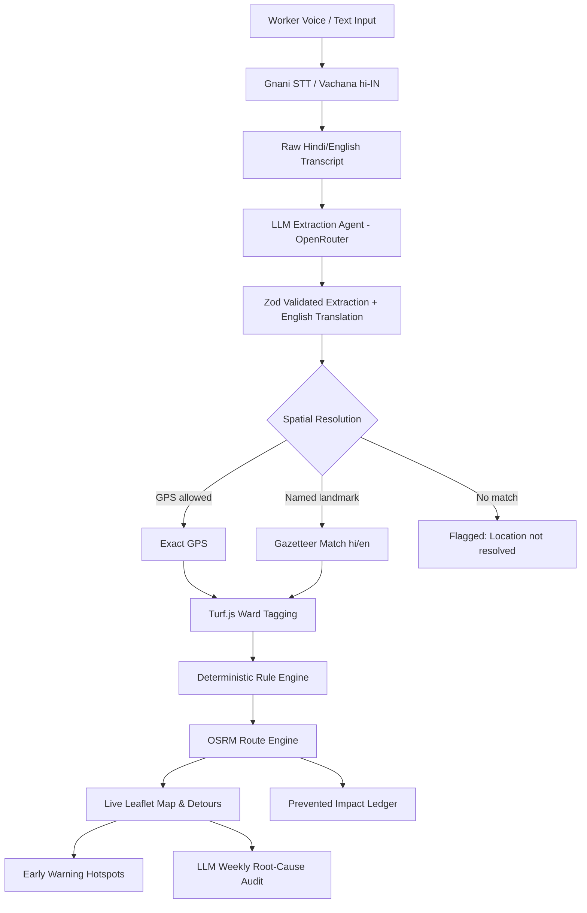

# SafaiKavach: AI Municipal Dispatch & Audit Engine

**Tagline:** Voice-first hazard intake, deterministic ward dispatch, and route bypass engine for municipal sanitation fleets.

SafaiKavach was built for the **AI First Product Builder Hackathon 2026** (Tracks: *Street Action* & *Waste Collection*). It gives sanitation workers and supervisors a fast, voice-driven interface to report road hazards (biohazards, live electrical wires, toxic chemicals, construction debris) in Hindi or English, extracts structured metadata without hallucinated coordinates, tags the incident to Delhi municipal wards, and generates truck bypass routes.

**Live Deployment:** [https://garbage-unstop-project.vercel.app/](https://garbage-unstop-project.vercel.app/)

---

## What the System Actually Does

1. **Voice & Text Hazard Reporting**
   - **Speech-to-Text:** Workers record audio directly in the browser. Audio is resampled to 16 kHz mono WAV and transcribed via Gnani STT (Vachana API in `hi-IN`). If Gnani is offline or credentials are unset, it falls back gracefully to a mock transcript.
   - **Text Input & Quick Prompts:** Works on mobile and desktop without microphone access using sample hazard buttons or manual input.
   - **Audio Robustness:** Audio recorder supports one-tap start/stop, enforces a 600 ms minimum audio threshold to prevent corrupt empty buffers, and handles browser pointer events safely.

2. **LLM Extraction & English Translation**
   - Raw transcripts (Hindi, Hinglish, or English) are parsed with an LLM (defaults to OpenRouter's free router `openrouter/free`, OpenAI-compatible).
   - Extracts a strict JSON schema validated via **Zod**:
     - `hazard_category`: Enforces one of 6 exact types (`biohazard_medical`, `construction_debris`, `electrical_hazard`, `chemical`, `general_overflow`, `unknown`).
     - `severity_level`: Integer 1 to 10 based on immediate physical risk.
     - `raw_location`: Spoken place or landmark name.
     - `translated_english`: Automatic English translation for Hindi transcripts.
   - **Fallback & Resilience:** Strips `<think>` blocks, enforces single-retry repair on invalid JSON, and degrades cleanly to `{ hazard_category: "unknown", severity_level: 5 }` with an on-screen diagnostic badge if the upstream provider fails.

3. **Deterministic Spatial Resolution & Ward Tagging**
   - **No Hallucinated Coordinates:** The LLM is strictly prohibited from guessing lat/long.
   - **Coordinate Hierarchy:**
     1. Device GPS (if browser geolocation is permitted).
     2. Gazetteer lookup against 15 Delhi landmarks (e.g., Connaught Place, Karol Bagh, Lajpat Nagar, with both English and Devanagari aliases like `करोल बाग`, `कनॉट प्लेस`).
     3. Unresolved: Saved with a clear *"Location not resolved"* badge; never dropped or faked.
   - **Ward Tagging:** Points are checked via point-in-polygon (`@turf/turf`) against actual Delhi MCD ward boundaries (`data/delhi_wards.json`).

4. **Deterministic Dispatch Rules & Routing**
   - Routing and dispatch decisions are **100% rule-based code** (never left to non-deterministic LLM hallucinations):
     - `dispatch_hazmat_bypass_standard`: Category is `biohazard_medical`, `chemical`, or `electrical_hazard` with Severity $\ge 6$. Standard truck is rerouted, specialized response is dispatched.
     - `bypass_standard`: Severity $\ge 7$ for other hazards. Standard collection truck bypasses the segment.
     - `routine_collection`: All lower severity reports.
   - **Route Engine:** Calculates planned, bypass, and hazmat routes using the public OSRM (Open Source Routing Machine) API with geodesic fallbacks if OSRM is unreachable.

5. **Live Interactive Map & Early Warning Panel**
   - **Live Map:** Interactive Leaflet map displaying active hazards, severity pins, ward polygons, and vehicle detour trajectories.
   - **Early Warning:** Calculates 4-week window trends across wards (W-3, W-2, W-1, W0) to surface hotspot spikes and projection counts before conditions worsen.
   - **Financial Ledger:** Calculates an estimated municipal damage prevention figure based on transparent baseline formulas (prevented medical/equipment damages minus detour transit costs).

6. **Weekly Audit Engine**
   - Groups multi-week reports into `(ward, category)` clusters.
   - Identifies the highest absolute anomaly increase week-over-week.
   - Uses an LLM to generate a structured root-cause diagnostic and concrete municipal action plan.

---

## What This Project Is NOT (Honest Scope & Limitations)

To keep this hackathon project transparent and grounded:
- **Synthetic Demonstration Data:** The demo comes preloaded with 60 synthetic reports across Delhi (`data/seed_raw.json` / `src/data/seed_reports.ts`) calibrated to demonstrate multi-week trend detection. Real submissions are saved directly to browser `localStorage`.
- **Database:** Prisma schema definitions are present for architectural demonstration (`prisma/schema.prisma`), but there is no live PostgreSQL database running in production to adhere to a serverless web scope.
- **Financial Numbers:** Prevented financial impact figures (`src/lib/finance/assumptions.ts`) are **illustrative assumptions**, not audited municipal ledgers.
- **Prediction Model:** The "Early Warning" system uses straightforward 4-week moving averages and weekly difference heuristics; it is **not** a complex neural network or trained predictive ML model.
- **OSRM Demo Server:** Road routing relies on the public open-source OSRM demo server and illustrative depot anchors (Karol Bagh depot, Okhla transfer station).

---

## Architecture Flow



---

## Tech Stack

| Layer | Technology | Purpose |
|---|---|---|
| **Framework** | Next.js 16 (App Router), React 19, TypeScript | Serverless web app & API routes |
| **Styling** | Tailwind CSS | Clean dark-mode operational dashboard |
| **Mapping** | Leaflet, React-Leaflet, Turf.js | Ward boundaries, hazard markers, detour lines |
| **Speech-to-Text** | Gnani Vachana STT API (`hi-IN`) | Indian-language voice transcription |
| **LLM Provider** | OpenRouter (`openrouter/free`) | Structured JSON hazard extraction & translation |
| **Validation** | Zod | Runtime schema validation on every boundary |
| **Routing** | OSRM (Open Source Routing Machine) | Turn-by-turn road routes and bypasses |
| **Testing** | Vitest | 36 unit tests covering routing, LLM, wards, and audit |

---

## Getting Started Locally

### 1. Clone & Install
```bash
git clone https://github.com/kaizen105/Garbage_unstop_project.git
cd Garbage_unstop_project
npm install
```

### 2. Configure Environment
Create a `.env` file in the root directory:
```env
# Optional: Gnani Vachana STT (if empty, uses fallback mock)
GNANI_API_KEY=
GNANI_STT_URL=https://api.vachana.ai/stt/v3

# LLM Provider (defaults to OpenRouter free models)
LLM_PROVIDER=openrouter
LLM_BASE_URL=https://openrouter.ai/api/v1
LLM_API_KEY=your_openrouter_api_key_here
LLM_MODEL_EXTRACT=openrouter/free
LLM_MODEL_AUDIT=openrouter/free

# Map provider
NEXT_PUBLIC_MAP_PROVIDER=leaflet
```

*(Note: If `LLM_API_KEY` is omitted, setting `LLM_PROVIDER=mock` allows 100% offline local development without external API calls).*

### 3. Run Dev Server
```bash
npm run dev
```
Open [http://localhost:3000](http://localhost:3000) in your browser.

---

## Verification & Testing

Every commit and deployment is verified with comprehensive automated tests and type checking:

```bash
# Run 36 Vitest unit tests
npm test

# Run TypeScript compilation check
npm run typecheck

# Run ESLint validation
npm run lint

# Build production bundle
npm run build
```

**Test Coverage Highlights:**
- **36 / 36 unit tests passing**
- STT audio payload validation, size limits, and 503 retry mechanics
- Turf.js spatial ward point-in-polygon matching and outside-boundary fallbacks
- OSRM route parsing, detour cost formulas, and geodesic fallbacks
- Anomaly cluster rankings with tie-break stability
- Zod schema validations across all API inputs

---

## Authors & Hackathon Submission
Built for the **AI First Product Builder Hackathon 2026**.
- **Live URL:** [https://garbage-unstop-project.vercel.app/](https://garbage-unstop-project.vercel.app/)
- **Repository:** [https://github.com/kaizen105/Garbage_unstop_project](https://github.com/kaizen105/Garbage_unstop_project)
