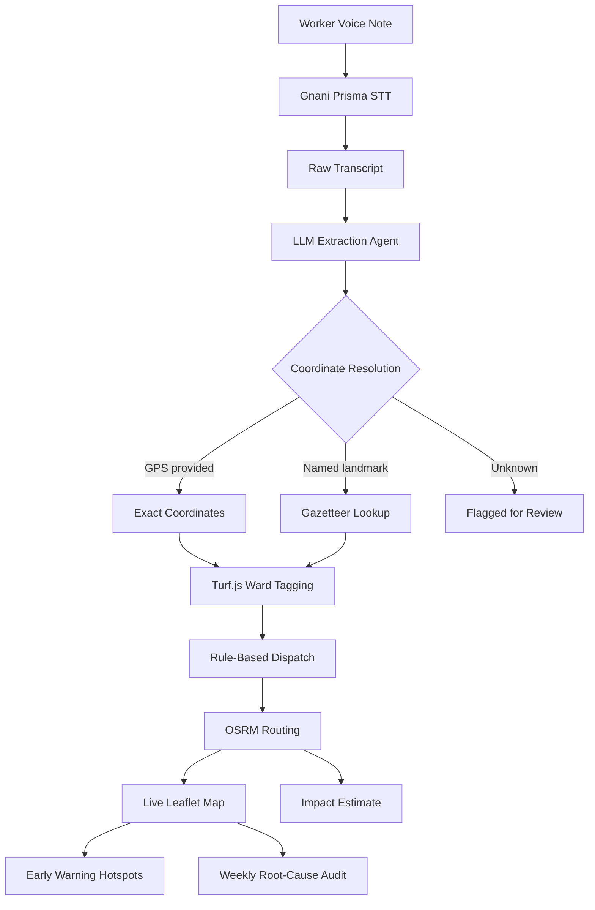

# SafaiKavach Architecture

## Core Pipeline

## Layer Descriptions

### Worker Voice Note
The process begins in the field when a sanitation worker encounters a hazardous situation (e.g., medical waste, large chemical spills). Using the mobile-responsive web UI, they press a single button to record a voice note in Hindi or English. The browser utilizes the native `MediaRecorder` API to capture the audio, enforcing a maximum 30-second duration and exporting it as a 16kHz WAV file.

### Gnani Prisma STT
The raw audio blob is transmitted to the Next.js backend `/api/transcribe` endpoint. From there, the payload is securely forwarded to the Gnani Prisma Speech-to-Text API. This layer performs acoustic processing and language detection, returning a structured text transcript of the worker's voice note. In the absence of API credentials, the system elegantly falls back to a deterministic mock transcript.

### LLM Extraction Agent
The raw transcript is pushed through an OpenRouter LLM adapter (compatible with standard OpenAI schemas). Utilizing structured prompting, the LLM parses the unstructured text to identify hazard categories, assess severity, recommend immediate actions, and extract spatial clues (like landmarks or street names). The output is strictly validated against a predefined Zod schema; any structural failure triggers a localized retry or a degraded fallback.

### Coordinate Resolution
Geospatial determination relies on deterministic methods rather than LLM hallucination. If the worker's device provides active GPS coordinates, they take absolute priority. If GPS is unavailable, the system scans the LLM's extracted location string against a local gazetteer (a JSON dictionary of known landmarks). If neither method yields a result, the incident is flagged for manual review with a null coordinate.

### Turf.js Ward Tagging
Once coordinates are successfully resolved, they are fed into Turf.js alongside the official GeoJSON boundaries of the Delhi MCD wards. The system runs a point-in-polygon algorithm to map the exact incident location to a specific municipal ward. This tagging is crucial for administrative accountability and statistical tracking.

### Rule-Based Dispatch & Routing
With the hazard classified and located, deterministic business rules assign the incident to standard or specialized fleets. The Open Source Routing Machine (OSRM) API then calculates dual pathing logic: it plots a bypass route for standard collection vehicles to avoid the hazard, and a direct response route for hazmat clearance teams.

### Live Dashboard & Impact Estimation
The verified incident and calculated routes are immediately published to the live React-Leaflet map. Simultaneously, a finance module applies illustrative heuristic models to estimate the net municipal costs prevented by actively avoiding the hazard (accounting for prevented injuries, vehicle damage, and downtime).

### Early Warning & Weekly Audit
Over time, historical ward data feeds into two analytical subsystems. The Early Warning module analyzes trailing 4-week reporting volumes using statistical anomalies (Z-scores) to shade wards proactively. Meanwhile, the Weekly Audit module batches clustered incidents and pushes them to a secondary LLM pipeline, which synthesizes root-cause summaries and policy mitigation suggestions for municipal planners.
